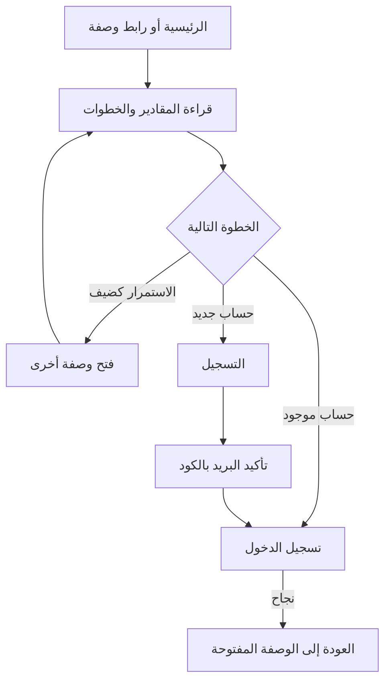
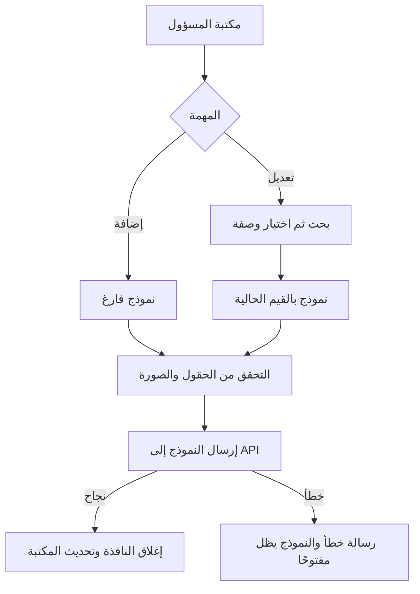

# Food Recipes

تطبيق React لتصفّح الوصفات وحفظ المفضلة وإدارة كتالوج الطعام. يبدأ الزائر القراءة فور فتح الموقع. بعد تسجيل الدخول، يرى القارئ مطبخه الشخصي، ويرى المسؤول مساحة إدارة الوصفات والتصنيفات والمستخدمين. هذا المستودع يحتوي على الواجهة الأمامية. خدمة خارجية تتولى الحسابات والتخزين وإرسال أكواد البريد.

[فتح الموقع](https://food-app-six-sepia.vercel.app/) · [تجربة وصفة كضيف](https://food-app-six-sepia.vercel.app/guest#lentil-soup) · [فتح الداشبورد](https://food-app-six-sepia.vercel.app/dashboard)

## 1. الأدوار والتنقل

| الدور | أول شاشة | المهام الأساسية |
| --- | --- | --- |
| ضيف | وصفة مميزة وفهرس ثلاث وصفات محلية | فتح المقادير والخطوات، الانتقال لوصفة أخرى، أو بدء التسجيل من الوصفة |
| قارئ «SystemUser» | My kitchen | تصفح كتالوج الـAPI، فتح التفاصيل، حفظ المفضلة وإزالتها، وإدارة حسابه |
| مسؤول «SuperAdmin» | Recipe library | البحث والإضافة والتعديل من الداشبورد، إدارة الوصفات والتصنيفات، وفحص حسابات المستخدمين |

القائمة العلوية للقارئ والقائمة الجانبية للمسؤول تستخدمان نفس مسارات التطبيق. على الشاشات الصغيرة ينتقل تنقل المسؤول إلى أعلى الصفحة. التبويب النشط يتحدد من الرابط، وقائمة **Account** تجمع الملف الشخصي وتغيير كلمة المرور والخروج.

### خريطة المسارات

| المسار | من يستطيع استخدامه؟ | السلوك عند فتحه |
| --- | --- | --- |
| `/` | الجميع | يفتح كتاب الوصفات للضيف، ويوجّه صاحب الجلسة إلى الداشبورد |
| `/guest` | الجميع | يفتح الوصفات المحلية، حتى أثناء تسجيل الدخول |
| `/login`، `/register`، `/verify` | زائر | تسجيل الدخول، إنشاء الحساب، ثم التحقق بالبريد |
| `/forget-password`، `/reset-password` | زائر | طلب كود استعادة ثم تعيين كلمة مرور جديدة |
| `/dashboard` | قارئ أو مسؤول | يختار الواجهة حسب الدور |
| `/recipes` | قارئ أو مسؤول | الكتالوج والفلاتر للجميع، مع إجراءات خاصة بالدور |
| `/favorites` | قارئ | قائمة الوصفات المحفوظة |
| `/categories`، `/users` | مسؤول | إدارة التصنيفات ودليل المستخدمين |
| `/profile`، `/ChangePassword` | قارئ أو مسؤول | تعديل البيانات والصورة أو تغيير كلمة المرور |
| `/recipe-data` | مستخدم مسجّل | رابط قديم يحوّل إلى الكتالوج. محرّر الوصفة يفتح داخل نافذة |

فتح مسار داخلي كضيف ينقل الزائر إلى تسجيل الدخول. فتح القارئ لرابط المستخدمين أو التصنيفات يعيده للداشبورد، وكذلك فتح المسؤول لرابط المفضلة. إخفاء الأزرار وتحويل المسارات مسؤولية الواجهة، والتحقق النهائي من صلاحية كل عملية مسؤولية الـAPI.

## 2. رحلة الضيف والتسجيل والعودة للوصفة



**مثال قابل للتجربة.** افتح `/guest#lentil-soup` ثم اضغط **Create an account** أسفل الوصفة. رابط التسجيل يحمل `?recipe=lentil-soup`. تحتفظ شاشات التحقق والدخول بهذه القيمة، وبعد النجاح يعود القارئ إلى `/guest#lentil-soup` مع فتح الوصفة والتمرير إليها. نفس المبدأ يعمل عند اختيار الدخول مباشرة، أو المرور باستعادة كلمة المرور. الدخول العادي يصل إلى الداشبورد. يطابق التطبيق القيمة مع معرّفات الوصفات المحلية المعروفة.

**مصدر المحتوى.** الباستا وسلطة الحمص وشوربة العدس محفوظة داخل المشروع. تتضمن كل وصفة وقت التحضير والمقادير والخطوات. الوصفات المسجّلة في الكتالوج تأتي من الخادم ولها معرّفات مستقلة ووصف وسعر وتصنيف وصورة. الاسم المتشابه بين المصدرين لا يربط سجلَّيهما تلقائيًا.

### الحساب والجلسة

1. **التسجيل.** يُدخل المستخدم اسم الحساب والبريد والدولة والهاتف وكلمة المرور وتأكيدها. قواعد النموذج تشترط اسمًا بحد أقصى ثمانية أحرف، يبدأ بحروف لاتينية وينتهي بأرقام. الهاتف من 10 إلى 15 رقمًا. كلمة المرور ستة محارف على الأقل وتشمل حرفًا كبيرًا وصغيرًا ورقمًا ورمزًا.
2. **التحقق.** يمرر التسجيل البريد في حالة التنقل. تعرض شاشة التحقق البريد والكود وتتيح إعادة الإرسال. عند الدخول المباشر للشاشة يمكن إدخال البريد يدويًا. نجاح التحقق ينقل المستخدم إلى الدخول.
3. **الدخول واستعادة الجلسة.** يحفظ التطبيق الـJWT تحت المفتاح `token` في التخزين المحلي. يقرأه AuthContext عند بدء التطبيق ويفكّ ترميزه، ويتخلص من التوكن غير القابل للقراءة أو المنتهي وفق حقل `exp` عند الاستعادة. يقرأ Axios التوكن عند كل طلب ويرسله في ترويسة `Authorization: Bearer …`.
4. **استعادة كلمة المرور.** يبدأ المستخدم ببريده، ثم يرسل البريد وكود إعادة التعيين وكلمة المرور الجديدة وتأكيدها. يستطيع إدخال البريد عند فتح صفحة التعيين مباشرة. بعد النجاح يعود إلى الدخول.
5. **الخروج.** يمسح التطبيق التوكن وحالة الجلسة وينقل المستخدم إلى الدخول. لا يوجد مسار لتسجيل حساب مسؤول من نموذج التسجيل العام.

## 3. داشبورد القارئ — My kitchen

| العنصر | ما يراه القارئ | ماذا يحدث عند التفاعل؟ |
| --- | --- | --- |
| الوصفة المميزة | صورة باستا الطماطم والريحان ووقت التحضير | يفتح **View recipe** الوصفة المحلية مباشرة، وتظل جلسة القارئ متاحة |
| My favorites | معاينة تطلب أول أربع مفضلات للحساب | الضغط على البطاقة يفتح الصورة والاسم والوصف في نافذة داخل الداشبورد |
| View all | رابط أعلى قسم المفضلة | يفتح القائمة الكاملة على `/favorites` |
| حساب جديد أو مفضلة فارغة | دعوة لحفظ أول وصفة | يفتح **Explore recipes** الكتالوج |
| أثناء الطلب أو فشله | رسالة تحميل أو خطأ | يتيح **Try again** إعادة تحميل المفضلة |

**مسار الحفظ.** من **Recipes** ابحث بالاسم أو اختر وسمًا وتصنيفًا، ثم افتح البطاقة لمراجعة التفاصيل. اضغط **Save recipe** من البطاقة. افتح **Favorites** لمراجعة المجموعة أو إزالة وصفة منها. الإزالة تستهدف سجل المفضلة الخاص بالحساب وتبقى الوصفة متاحة في الكتالوج. تعرض صفحة المفضلة 12 عنصرًا في الصفحة، وتعود للصفحة السابقة عند إزالة آخر عنصر من صفحة لاحقة.

## 4. داشبورد المسؤول — Recipe library

يعرض رأس الصفحة زر **Add recipe** وثلاثة مؤشرات للوصفات والتصنيفات والمستخدمين. تستعمل المؤشرات إجمالي السجلات الذي يرجعه الخادم. مؤشر الوصفات يطلب الإجمالي بصورة مستقلة عن البحث، لذلك يظل إجمالي المكتبة ظاهرًا عند تضييق النتائج. الشرطة في مكان الرقم تعني أن الإجمالي غير متاح.

جدول الداشبورد يطلب ست وصفات في الصفحة. البحث بالاسم يعيد العرض إلى الصفحة الأولى. كل صف يعرض الصورة والاسم والتصنيف وزر **Edit**. يفتح زرا الإضافة والتعديل المحرّر نفسه المستخدم في الكتالوج، ويتاحان بعد تحميل خيارات الوسوم والتصنيفات. عند نجاح الحفظ تُغلق النافذة ويُعاد جلب بيانات الجدول والإجماليات. حذف وصفة متاح في تبويب **Recipes**.



## 5. تفاصيل التبويبات الداخلية

### Recipes

- يعرض الكتالوج بطاقات بها الصورة والاسم والتصنيف والوسم والسعر بالجنيه المصري إذا توفرت البيانات. تفتح البطاقة نافذة التفاصيل. تستخدم الصورة الاحتياطية المحلية عندما يغيب مسار الصورة.
- يدعم البحث بالاسم وفلاتر الوسم والتصنيف، ومسح الفلاتر وتغيير حجم الصفحة إلى 6 أو 12 أو 24 أو 48. البداية عند 12. تغيير الفلاتر يعيد التصفح إلى الصفحة الأولى.
- يستطيع القارئ حفظ وصفة أو إلغاء حفظها. يستطيع المسؤول إضافة وصفة أو تعديلها أو طلب حذفها. الحذف يمر بنافذة تأكيد.
- يجمع المحرّر الاسم والوصف والسعر والوسم والتصنيف والصورة. الإضافة تتطلب صورة. عند التعديل يمكن الاحتفاظ بالصورة الحالية أو رفع بديل. انظر تفاصيل الحقول في عقد الـAPI أدناه.

### Categories

تعرض الصفحة إجمالي النتائج وأسماء التصنيفات وتاريخ الإنشاء وآخر تعديل. يمكن البحث بالاسم وتغيير عدد الصفوف. يبدأ العرض بعشرة تصنيفات. يفتح **Add category** نموذجًا فارغًا، ويفتح **Edit** الاسم الحالي للتعديل. يمنع النموذج حفظ اسم فارغ أو مكوّن من مسافات فقط. يؤكد المسؤول الحذف قبل الإرسال. تعاد قراءة الصفحة بعد نجاح التغيير.

### Users

يفصل دليل المستخدمين بين كتابة الفلاتر وتطبيقها بزر **Apply filters**. يرسل اسم الحساب والدولة والمجموعة ورقم الصفحة وحجمها للخادم. يعمل حقل **Email on this page** على صفوف الصفحة المستلمة فقط، لذلك قد تجد البريد المطلوب في صفحة أخرى. يبدأ الدليل بعشرة حسابات في الصفحة، ويمكن اختيار 5 أو 10 أو 25 أو 50.

تفتح **Details** بيانات الحساب، بما فيها البريد والهاتف والدولة والدور والمعرّف وتاريخ الانضمام عند توفرها. يظهر إجراء الحذف لحساب القارئ من نوع `SystemUser`، ويتطلب تأكيدًا ثانيًا. عند فشل الحذف تعرض النافذة الخطأ. سجلات هذا التبويب تأتي من الـAPI الإداري.

### Profile وChange password

تعرض صفحة الملف تفاصيل الحساب ونموذجًا مُعبّأً بالقيم الحالية. يستطيع المستخدم تعديل الاسم والبريد والدولة والهاتف وتقديم كلمة المرور للتأكيد. تغيير الصورة له إجراء مستقل يطلب ملفًا وتأكيد كلمة المرور، ثم يعيد جلب الملف الشخصي بعد النجاح. إذا تعذر تحميل الملف تظهر إعادة المحاولة.

تطلب صفحة تغيير كلمة المرور القيمة الحالية والجديدة وتأكيد الجديدة، وتتحقق من التطابق. نجاح الطلب يعيد المستخدم إلى الداشبورد. مسار استعادة الحساب من شاشة الدخول منفصل ويعتمد على كود يصل بالبريد.

## 6. بنية البرنامج ومسؤوليات الملفات

| نقطة الدخول أو المجلد | المسؤولية |
| --- | --- |
| [main.jsx](src/main.jsx) و[App.jsx](src/App.jsx) | تركيب React وموفّري الحالة وتعريف شجرة المسارات |
| [AuthContext](src/context/AuthContext.jsx) و[ProtectedRoute](src/modules/shared/components/ProtectedRoute/ProtectedRoute.jsx) | استعادة الجلسة وتحديثها والخروج وحراسة المسارات الداخلية |
| [MasterLayout](src/modules/shared/layouts/MasterLayout/MasterLayout.jsx) | اختيار تنقل القارئ أو المسؤول، تمييز التبويب، قائمة الحساب وتحويل المسارات الخاصة بالدور |
| [Dashboard](src/modules/HomeModule/components/Dashboard/Dashboard.jsx) | اختيار لوحة القارئ أو المسؤول وتنسيق الطلبات والإجراءات لكل منهما |
| [guestRecipes](src/modules/recipes/guestRecipes.js) و[GuestRecipes](src/modules/recipes/components/GuestRecipes.jsx) | المحتوى المحلي وفهرس الوصفات وروابط الرجوع بعد الدخول |
| [مكوّنات الوصفات](src/modules/recipes/components/) | الكتالوج، نافذة التحرير المشتركة، البطاقة، المفضلة والتنقل بين الصفحات |
| [التصنيفات](src/modules/categories/) و[المستخدمون](src/modules/users/) | إدارة التصنيفات، دليل الحسابات والملف الشخصي |
| [نماذج الحساب](src/modules/authentication/) و[قواعد التحقق](src/services/validations.js) | التسجيل والتحقق والدخول والاستعادة وتغيير كلمة المرور |
| [DataContext](src/context/DataContext.jsx) | عمليات الكتابة، تحديث الملف والصورة، جلب المفضلة وتبديل حالة الحفظ |
| [usePage](src/services/api/usePage.js) | قراءة القوائم والعدادات وربط الاستجابة بالطلب الحالي وإلغاء الطلب عند تغير المعاملات |
| [Axios](src/services/api/index.js) و[عناوين الخدمات](src/services/api/urls.js) | عنوان الـAPI وترويسة الجلسة ومسارات الموارد وأصل الصور |

**كيف يصل صف البحث إلى الشاشة؟** يعدّل إدخال المستخدم حالة الفلاتر. يبني `usePage` مفتاحًا من المورد ورقم الصفحة وحجمها والفلاتر ورقم التحديث، ثم يرسل GET. عند تغيّر المفتاح يُلغى الطلب السابق وتُعرض نتيجة المفتاح الحالي فقط. بعد الكتابة الناجحة تزيد الشاشة رقم التحديث لإعادة القراءة. يستخدم دليل المستخدمين طلبًا مستقلًا لأن فلاتره وبياناته تختلف عن الكتالوج.

## 7. عقد الواجهة مع الـAPI

عنوان الخدمة المعرّف في المصدر هو `https://upskilling-egypt.com:3006/api/v1`. لعرض صورة مرفوعة، تجمع الواجهة بين `https://upskilling-egypt.com:3006` و`imagePath`. المسارات في الجدول نسبية إلى عنوان الخدمة، وهي توثّق استدعاءات هذا التطبيق.

| الوظيفة | الطلب | البيانات أو النتيجة المستخدمة |
| --- | --- | --- |
| تسجيل ودخول | `POST /Users/Register`، `POST /Users/Login` | بيانات الحساب عند التسجيل، والبريد وكلمة المرور عند الدخول. تستعمل الواجهة الحقل `token` من نتيجة الدخول |
| تحقق وإعادة إرسال | `PUT /Users/verify`، `POST /Users/verify` | التحقق يرسل البريد والكود، وإعادة الإرسال ترسل البريد |
| استعادة الحساب | `POST /Users/Reset/Request`، `POST /Users/Reset` | طلب الكود بالبريد ثم تعيين كلمة مرور جديدة. اسم حقل الكود في نموذج التعيين هو `seed` |
| ملف الحساب | `GET /Users/currentUser`، `PUT /Users` | قراءة بيانات الحساب وتحديثها باستخدام FormData |
| تغيير كلمة المرور | `PUT /Users/ChangePassword` | `oldPassword` و`newPassword` و`confirmNewPassword` |
| كتالوج الوصفات | `GET /Recipe` | `pageNumber` و`pageSize`، مع `name` و`tagId` و`categoryId` عند الاختيار |
| إدارة وصفة | `POST /Recipe`، `PUT /Recipe/{id}`، `DELETE /Recipe/{id}` | الإضافة والتعديل يستخدمان multipart. الحذف يستخدم معرّف الوصفة |
| تصنيفات ووسوم | `GET /Category`، `GET /tag` | التصنيفات ترجع في صفحة بيانات. يُستخدم رد الوسوم كمصفوفة |
| إدارة تصنيف | `POST /Category`، `PUT /Category/{id}`، `DELETE /Category/{id}` | الإضافة والتعديل يرسلان كائنًا يحتوي على `name` |
| المفضلة | `GET /userRecipe`، `POST /userRecipe`، `DELETE /userRecipe/{id}` | الإضافة ترسل `recipeId`. الحذف يستعمل معرّف سجل المفضلة |
| دليل الحسابات | `GET /Users`، `DELETE /Users/{id}` | قراءة الحسابات بفلاتر وترقيم صفحات، وحذف الحساب المحدد بعد التأكيد |

**أمثلة للمطوّر**

```http
GET /api/v1/Recipe?name=soup&pageNumber=1&pageSize=12
```

تقرأ الواجهة صفوف القوائم من `data`، وإجمالي الصفحات من `totalNumberOfPages`، وعدد السجلات من `totalNumberOfRecords`. مثال توضيحي لسجل مفضلة:

```json
{"id": 9, "recipe": {"id": 42, "name": "Red lentil soup"}}
```

لإضافة هذه الوصفة يُرسل `{"recipeId":42}`، ولإزالة الحفظ يُستخدم `DELETE /userRecipe/9`. الخلط بين المعرّفين يوجّه الطلب إلى سجل آخر.

**حمولة محرّر الوصفة.** الحقول النصية هي `name` و`description`. يرسل `price` و`tagId` بعد تحويلهما إلى عدد صحيح، و`categoriesIds` بقيمة التصنيف المختار. يُرسل الملف الجديد باسم `recipeImage`، أو مسار الصورة القديمة في `imagePath` عند الاحتفاظ بها.

## 8. التشغيل والنشر

المشروع يستخدم React 18 وReact Router 6 وVite 5، مع Axios وReact Hook Form وBootstrap وReact Bootstrap. استخدم Node.js 24 وnpm من جذر المستودع.

```sh
git clone https://github.com/onisEg/food_app.git
cd food_app
npm ci
npm run dev
```

افتح العنوان الذي يطبعه Vite. يمكن مراجعة صفحات الضيف فورًا. لاختبار التسجيل ستحتاج بريدًا يستقبل الأكواد، ولاختبار الإدارة ستحتاج حسابًا يحمل دور المسؤول لدى الخدمة.

| الأمر | النتيجة |
| --- | --- |
| `npm run lint` | فحص المصدر باستخدام ESLint |
| `npm run build` | إنشاء حزمة الإنتاج في `dist/` |
| `npm run preview` | تشغيل الحزمة المبنية محليًا |
 
يُنشر مشروع Vite على Vercel من فرع `main`، ومجلد المخرجات هو `dist`. يعيد [vercel.json](vercel.json) كتابة المسارات الخالية من امتدادات الملفات إلى `index.html` ليعمل التحديث المباشر داخل التابات. تمر طلبات الصور والأصول ذات الامتداد إلى ملفاتها. نشر الواجهة لا ينشر خدمة الحسابات أو البريد أو قاعدة البيانات.

## 9. خطة القبول وإعادة الاختبار

استخدم بيانات قابلة للتخلص منها عند اختبار الإنشاء والتعديل والحذف. اختبارات الواجهة بردود API محاكية تثبت انتقالات الواجهة وشكل الطلب. استخدم حسابات الاختبار الفعلية للتحقق من تسليم البريد، وصلاحيات الخادم، وبقاء التغيير بعد إعادة التحميل.

| السيناريو | خطوات المراجعة | النتيجة المتوقعة |
| --- | --- | --- |
| ضيف جديد | افتح الرئيسية في نافذة خاصة ثم افتح شوربة العدس وانتقل إلى وصفة أخرى | المقادير والخطوات متاحة دون حساب |
| العودة بعد التسجيل | سجّل من وصفة مفتوحة، تحقّق بالكود ثم سجّل الدخول | تظهر نفس الوصفة مفتوحة. الدخول من رابط الدخول العام يفتح الداشبورد |
| استعادة الحساب | اطلب الكود ثم عيّن كلمة مرور وجرّب الدخول | يقبل الخادم الجديدة وتكتمل وجهة الرجوع |
| قارئ | ابحث واحفظ وصفة ثم افتح الداشبورد والمفضلة وأزلها وأعد التحميل | تظهر المفضلة للحساب وتُزال بعد النجاح وتبقى الوصفة في الكتالوج |
| مسؤول | أنشئ تصنيفًا ووصفة تجريبية، عدّل الوصفة مع الاحتفاظ بالصورة ثم احذف الوصفة قبل التصنيف | تُعرض القيم المحفوظة وتُحدّث القوائم |
| دليل المستخدمين | طبّق فلتر دور، افتح التفاصيل، ثم افتح تأكيد الحذف وألغِه | تظهر بيانات الحساب المحدد ويبقى الحساب بعد الإلغاء |
| حدود التنقل | افتح رابطًا داخليًا دون جلسة، ثم افتح رابط المستخدمين كقارئ | الأولى تصل إلى الدخول، والثانية إلى داشبورد القارئ |
| الملف والأمان | عدّل بيانات حساب اختبار، ثم جرّب تغيير كلمة المرور مع تأكيد غير مطابق | تعكس القراءة التالية القيم المحفوظة ويمنع النموذج إرسال التأكيد المخالف |
| حالات الفشل والموبايل | عطّل الشبكة أثناء تحميل قائمة، ثم استعد الاتصال وأعد المحاولة. افتح التابات بعرض هاتف | تظهر حالة خطأ قابلة للفهم، وتبقى عناصر التنقل والإجراءات قابلة للاستخدام |
| إصدار الإنتاج | افتح رابط تاب مباشرة ثم حدّث الصفحة وتحقق من تحميل الصورة المميزة | يعمل توجيه التطبيق بعد التحديث وتُخدم الأصول من مساراتها |

**حالة التحقق.** شُغّل بناء الإنتاج وESLint. شملت اختبارات التفاعل ببيانات محاكية أدوار الضيف والقارئ والمسؤول، والرجوع للوصفة بعد الدخول والتسجيل، والبحث، وفتح محرّر الوصفة وتعديلها، وتعديل تصنيف، وإزالة مفضلة، وفتح تفاصيل مستخدم. هذه الاختبارات استُخدمت أثناء التطوير خارج المستودع. لا يعرّف المشروع حاليًا أمر `npm test`. لم يتم التحقق من وصول بريد حقيقي أو تنفيذ عمليات كتابة بحساب إنتاج ضمن هذه المراجعة.

## 10. تشخيص المشكلات والتحسينات

| العرض | ما الذي تفحصه؟ |
| --- | --- |
| الضيف يرى الوصفات لكن الدخول أو الكتالوج يفشل | المحتوى العام محلي. افحص حالة طلب الحساب أو الكتالوج في Network، وعنوان الخدمة واستجابة الخادم |
| المستخدم يعود إلى الداشبورد عند فتح رابط | تحقق من الدور المطلوب للتاب. للرجوع إلى وصفة عامة بعد الدخول يجب أن يبدأ المسار من وصفة معروفة تحمل معامل `recipe` |
| زر إضافة وصفة معطّل | افحص تحميل `/tag` و`/Category`. يحتاج المحرّر إلى خياراتهما |
| نتيجة البحث عن بريد تبدو ناقصة | فلتر البريد محلي على الصفحة الحالية. استخدم فلتر الاسم أو انتقل للصفحة المناسبة |
| صورة مرفوعة لا تظهر | افحص عنوان الصورة الناتج من أصل الصور و`imagePath`، ثم حالة طلب الملف |
| تحديث رابط داخلي يعرض 404 من المضيف | تحقق من إعادة الكتابة في Vercel ومن نشر `dist` الصحيح |

**أولويات التطوير التالية**

1. تثبيت اختبارات الداشبورد والعودة للوصفة في المستودع وربطها بفحص تلقائي قبل الدمج، مع اختبار منفصل للبريد وعمليات الكتابة في بيئة تجريبية.
2. حسم دقة السعر مع خدمة الوصفات. يسمح النموذج بالقيم العشرية بينما يحولها مزوّد البيانات إلى أعداد صحيحة. ينبغي أن يحفظ اختبار الرجوع القيمة بعد فتح المحرّر مجددًا.
3. مراجعة الحسابات ذات البيانات الكبيرة. قوائم اختيار التصنيفات تطلب أول 100 عنصر، وبحث البريد يغطي صفحة واحدة. اختبر تصنيفًا وبريدًا بعد حدود الصفحة قبل تغيير عقد الـAPI.
4. مراجعة انتهاء الجلسة أثناء الاستخدام. فحص انتهاء التوكن يجري عند استعادته، وعميل Axios يحتوي على معترض للطلب. معالجة موحّدة لاستجابة انتهاء الجلسة ستجعل العودة للدخول أوضح عبر التابات.
