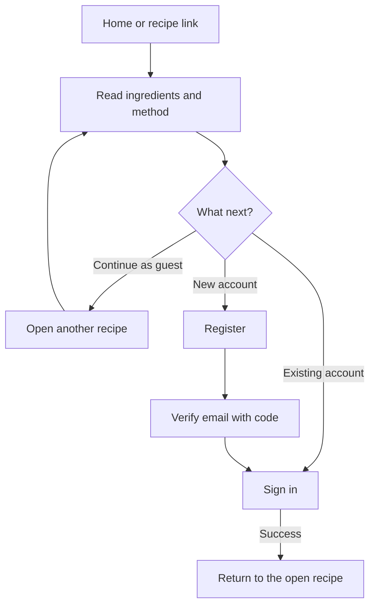
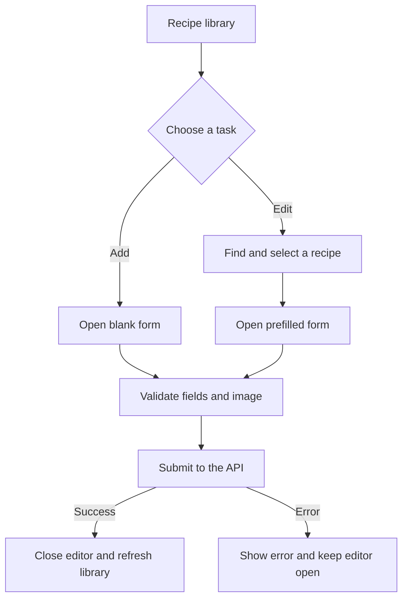

# Food Recipes

Food Recipes is a React application for reading recipes, saving favorites, and managing a food catalog. Guests can start cooking from the home page. After sign-in, readers get a personal kitchen and administrators get a workspace for managing recipes, categories, and users. This repository contains the frontend. An external API handles accounts, persistent data, and verification emails.

[Open the app](https://food-app-six-sepia.vercel.app/) · [Read a recipe as a guest](https://food-app-six-sepia.vercel.app/guest#lentil-soup) · [Open the dashboard](https://food-app-six-sepia.vercel.app/dashboard)

## 1. Roles and navigation

| Role | Landing screen | Main tasks |
| --- | --- | --- |
| Guest | Featured dish and an index of three local recipes | Read ingredients and instructions, open another recipe, or create an account from the current recipe |
| Reader (`SystemUser`) | My kitchen | Browse the API catalog, open recipe details, save or remove favorites, and manage a personal account |
| Administrator (`SuperAdmin`) | Recipe library | Search, add, and edit recipes from the dashboard, maintain categories, and review user accounts |

Readers use a top navigation bar. Administrators use a sidebar that moves above the content on smaller screens. The current URL determines the active tab. The **Account** menu includes profile settings, password changes, and logout.

### Route map

| Route | Audience | Behavior |
| --- | --- | --- |
| `/` | Everyone | Opens the guest cookbook for visitors and sends signed-in users to their dashboard |
| `/guest` | Everyone | Opens the local cookbook, including during a signed-in session |
| `/login`, `/register`, `/verify` | Signed-out visitors | Sign in, create an account, and verify an email address |
| `/forget-password`, `/reset-password` | Signed-out visitors | Request a reset code and set a new password |
| `/dashboard` | Reader or administrator | Selects the workspace for the account’s role |
| `/recipes` | Reader or administrator | Displays the catalog and filters with role-specific actions |
| `/favorites` | Reader | Displays the account’s saved recipes |
| `/categories`, `/users` | Administrator | Opens category management or the user directory |
| `/profile`, `/ChangePassword` | Reader or administrator | Updates account details, the profile picture, or the current password |
| `/recipe-data` | Signed-in users | Redirects this legacy URL to the catalog. The recipe editor opens in a dialog |

Opening a protected route as a guest leads to sign-in. A reader who follows a direct link to Users or Categories returns to the dashboard. The same happens when an administrator opens Favorites. The frontend controls navigation and visible actions. The external API is responsible for authorizing each request.

## 2. Guest journey and account lifecycle



**Try the return flow.** Open `/guest#lentil-soup` and select **Create an account** below the recipe. The registration link carries `?recipe=lentil-soup`. Verification and sign-in preserve this value. After sign-in, the app opens `/guest#lentil-soup`, expands the recipe, and scrolls it into view. Direct sign-in from a recipe and password recovery also preserve this destination. Ordinary sign-in opens the dashboard. The app accepts recipe identifiers from its local cookbook.

**Recipe sources.** The pasta, chickpea salad, and lentil soup recipes ship with the frontend. Each has a cooking time, ingredients, and method. Catalog recipes come from the API and have their own IDs, descriptions, prices, classifications, and images. A matching dish name does not establish a relationship between these two data sources.

### Accounts and sessions

1. **Register.** Enter a username, email, country, phone number, password, and password confirmation. A username contains up to eight characters, starts with Latin letters, and ends with digits. Phone numbers contain 10–15 digits. Passwords require at least six characters, including uppercase and lowercase letters, a digit, and a symbol.
2. **Verify the email address.** Registration passes the email address in router state. The verification screen accepts the code and can resend it. Visitors who open the screen directly can enter their email manually. Successful verification opens sign-in.
3. **Sign in and restore a session.** The app stores the JWT under `token` in local storage. On startup, `AuthContext` decodes the saved token and discards unreadable tokens and tokens that have expired according to their `exp` claim. Axios reads the token before each request and adds the `Authorization: Bearer …` header when one is present.
4. **Recover a password.** Request a code by email, then submit the email address, reset code, new password, and confirmation. The reset screen also accepts an email address when opened directly. Success returns the user to sign-in.
5. **Log out.** Logout clears the stored token and in-memory session, then opens sign-in. Public registration does not provide a way to create an administrator account.

## 3. Reader dashboard — My kitchen

| Element | What the reader sees | Action |
| --- | --- | --- |
| Featured meal | Tomato and basil pasta with a photograph and cooking time | **View recipe** opens the local recipe and preserves the reader’s session |
| My favorites | A preview requesting the first four saved items | Select a card to open its image, name, and description in a dashboard dialog |
| View all | A link beside the favorites heading | Opens the complete collection at `/favorites` |
| Empty collection | An invitation to save the first recipe | **Explore recipes** opens the catalog |
| Loading or failed request | A loading message or an error | **Try again** requests the favorites again |

**Save a recipe.** In **Recipes**, search by name or narrow the catalog by tag and category. Open a card to read the details, then select **Save recipe** on the card. Open **Favorites** to review the collection or remove an item. Removal deletes the account’s favorite record. The catalog recipe remains available. Favorites shows 12 items per page and returns to the previous page when the reader removes the last item from a later page.

## 4. Administrator dashboard — Recipe library

The dashboard header provides **Add recipe** and three counts for recipes, categories, and users. Each count uses the total record count returned by the API. The recipe total is fetched separately from the search results, so filtering the table preserves the library-wide count. A dash indicates an unavailable total.

The dashboard requests six recipes per page. Searching by name returns the table to page one. Each row shows the image, name, category, and **Edit** action. Add and edit use the catalog’s shared recipe editor and become available when the tag and category options have loaded. A successful save closes the dialog and refreshes dashboard data. Administrators can delete a recipe from the **Recipes** tab.



## 5. Workspace tabs

### Recipes

- Each card shows the recipe image, name, category, tag, and price in EGP when available. Selecting the card opens the details dialog. A local fallback image is used when the record has no image path.
- Search by name, filter by tag and category, clear the filters, or select 6, 12, 24, or 48 items per page. The default is 12. Changing filters returns to page one.
- Readers can save recipes and remove them from their favorites. Administrators can create and edit recipes. Deletion opens a confirmation dialog before sending the request.
- The editor collects the name, description, price, tag, category, and image. Creating a recipe requires an image. Editing can retain the current image or upload a replacement. Section 7 lists the submitted fields.

### Categories

The category list shows the result count, category names, creation dates, and last update dates. Search by name or change the page size. The default is ten categories per page. **Add category** opens a blank form. **Edit** opens the selected name for editing. The form rejects empty and whitespace-only names. Deletion requires confirmation. A successful change refreshes the listing.

### Users

Enter directory filters, then select **Apply filters**. The frontend sends the username, country, group, page number, and page size to the server. **Email on this page** filters only the records returned for the current page. An account with the desired email may appear on another page. The default page size is ten, with options for 5, 10, 25, or 50 accounts.

**Details** opens the selected account’s email, phone, country, role, ID, and join date when available. A reader account with the `SystemUser` role has a delete action that requires a second confirmation. The dialog displays a failure if deletion is unsuccessful. This tab reads its records from the administrative API.

### Profile and Change password

Profile displays account details and a form prefilled with the current values. Users can edit their username, email, country, and phone number and provide their password to confirm. Updating a profile image uses a separate file selection and password-confirmation flow. Success reloads the profile. A failed profile load offers a retry.

Change password asks for the current password, new password, and confirmation, and validates that the new values match. Success opens the dashboard. Signed-out account recovery uses a separate email-code flow.

## 6. Architecture and source map

| Entry point or directory | Responsibility |
| --- | --- |
| [main.jsx](src/main.jsx) and [App.jsx](src/App.jsx) | Mount React, install the context providers, and define the route tree |
| [AuthContext](src/context/AuthContext.jsx) and [ProtectedRoute](src/modules/shared/components/ProtectedRoute/ProtectedRoute.jsx) | Restore and update sessions, handle logout, and guard signed-in routes |
| [MasterLayout](src/modules/shared/layouts/MasterLayout/MasterLayout.jsx) | Select role-specific navigation, highlight the active tab, display account controls, and redirect role-restricted routes |
| [Dashboard](src/modules/HomeModule/components/Dashboard/Dashboard.jsx) | Render the reader or administrator workspace and coordinate its requests and actions |
| [Guest recipe data](src/modules/recipes/guestRecipes.js) and [GuestRecipes](src/modules/recipes/components/GuestRecipes.jsx) | Provide local content, the recipe index, and return links for sign-in |
| [Recipe components](src/modules/recipes/components/) | Implement the catalog, shared editor, recipe cards, favorites, and pagination |
| [Categories](src/modules/categories/) and [Users](src/modules/users/) | Implement category management, the user directory, and profile controls |
| [Account forms](src/modules/authentication/) and [validation rules](src/services/validations.js) | Handle registration, verification, sign-in, recovery, and password changes |
| [DataContext](src/context/DataContext.jsx) | Coordinate write operations, profile and image updates, favorites retrieval, and save toggles |
| [usePage](src/services/api/usePage.js) | Fetch lists and counts, associate responses with the current query, and cancel superseded requests |
| [Axios client](src/services/api/index.js) and [service URLs](src/services/api/urls.js) | Configure the API origin, authorization header, resource paths, and image origin |

**Tracing a catalog search.** Input changes the screen’s filter state. The `usePage` hook builds a key from the resource, page number, page size, filters, and refresh revision, then issues a GET request. When these inputs change, it cancels the previous request and exposes only a result matching the current key. After a successful write, the screen increments the revision to fetch updated data. The user directory has a separate request because it uses account-specific filters and response fields.

## 7. Frontend API contract

The configured API base is `https://upskilling-egypt.com:3006/api/v1`. Uploaded image URLs combine `https://upskilling-egypt.com:3006` with the record’s `imagePath`. The paths below are relative to the API base and describe calls made by this frontend.

| Operation | Request | Payload or response used |
| --- | --- | --- |
| Register and sign in | `POST /Users/Register`, `POST /Users/Login` | Registration sends account details. Sign-in sends the email and password and reads the returned `token` |
| Verify or resend | `PUT /Users/verify`, `POST /Users/verify` | Verification sends the email and code. Resending sends the email |
| Recover account | `POST /Users/Reset/Request`, `POST /Users/Reset` | Request the code by email, then submit the replacement password. The reset form calls the code field `seed` |
| Read and update profile | `GET /Users/currentUser`, `PUT /Users` | Read account details and submit updates as FormData |
| Change password | `PUT /Users/ChangePassword` | Send `oldPassword`, `newPassword`, and `confirmNewPassword` |
| Browse recipes | `GET /Recipe` | Send `pageNumber` and `pageSize`, plus `name`, `tagId`, and `categoryId` when selected |
| Manage recipes | `POST /Recipe`, `PUT /Recipe/{id}`, `DELETE /Recipe/{id}` | Create and update use multipart form data. Deletion targets the recipe ID |
| Read categories and tags | `GET /Category`, `GET /tag` | Categories use a paginated result. The tag response is consumed as an array |
| Manage categories | `POST /Category`, `PUT /Category/{id}`, `DELETE /Category/{id}` | Create and update send an object containing `name` |
| Manage favorites | `GET /userRecipe`, `POST /userRecipe`, `DELETE /userRecipe/{id}` | Creation sends `recipeId`. Deletion targets the favorite record ID |
| Manage directory | `GET /Users`, `DELETE /Users/{id}` | Read filtered and paginated accounts or delete the confirmed selection |

### Request and record examples

```http
GET /api/v1/Recipe?name=soup&pageNumber=1&pageSize=12
```

Paginated screens read rows from `data`, the page count from `totalNumberOfPages`, and the record count from `totalNumberOfRecords`. A favorite wraps a recipe in a separate record. For example:

```json
{"id": 9, "recipe": {"id": 42, "name": "Red lentil soup"}}
```

To save this recipe, send `{"recipeId":42}`. To remove that favorite, call `DELETE /userRecipe/9`. Using the nested recipe ID for deletion would target the wrong favorite record.

**Recipe editor payload.** The text fields are `name` and `description`. The provider converts `price` and `tagId` to integers and sends the selected category as `categoriesIds`. A new file is sent as `recipeImage`. An edit that keeps the current image can send its existing `imagePath`.

## 8. Local setup and deployment

The app uses React 18, React Router 6, Vite 5, Axios, React Hook Form, Bootstrap, and React Bootstrap. Use Node.js 24 and npm.

```sh
git clone https://github.com/onisEg/food_app.git
cd food_app
npm ci
npm run dev
```

Open the local URL printed by Vite. Guest pages work immediately. Registration testing requires an inbox that can receive verification codes. Administration testing requires an account assigned the administrator role by the external service.

| Command | Result |
| --- | --- |
| `npm run lint` | Check the source with ESLint |
| `npm run build` | Generate the production bundle in `dist/` |
| `npm run preview` | Serve the built bundle locally |

Vercel deploys the Vite project from `main` using `dist` as its output directory. The [Vercel configuration](vercel.json) rewrites extensionless routes to `index.html` so a direct visit or refresh works inside a tab. Assets with file extensions are served from their own paths. The account service, email delivery, and database are hosted separately from this frontend.

## 9. Acceptance and regression testing

Use disposable records for create, edit, and delete scenarios. Mocked API responses let reviewers verify navigation and outgoing request shapes. Test accounts against a real service are needed to verify email delivery, backend permissions, and persistence after reload.

| Scenario | Steps | Expected result |
| --- | --- | --- |
| New guest | Open Home in a private window, expand lentil soup, then open another recipe | Ingredients and instructions are available before sign-in |
| Return after registration | Register from an open recipe, verify the code, and sign in | The same recipe reopens. Ordinary sign-in from the general login page opens the dashboard |
| Account recovery | Request a code, set a new password, and sign in | The service accepts the new password and the intended return flow completes |
| Reader favorites | Search, save a recipe, check the dashboard and Favorites, remove it, then reload | The saved item belongs to the account. Removal persists and the catalog recipe remains |
| Administrator editing | Create a disposable category and recipe, edit the recipe while keeping its image, then delete the recipe before its category | Saved values appear in subsequent reads and the affected lists refresh |
| User directory | Apply a role filter, open details, start deletion, and cancel | The dialog displays the selected account and cancellation preserves it |
| Navigation boundaries | Open a protected link while signed out, then open Users as a reader | The first visit opens sign-in and the second returns to the reader dashboard |
| Profile and password | Update a test profile and try submitting mismatched password confirmation | A subsequent read shows the saved profile. The password form rejects the mismatch |
| Failure and mobile layouts | Interrupt a list request, restore connectivity, and retry. Open the tabs at phone width | The failed request shows a readable error. Navigation and actions remain usable at the smaller width |
| Production routing | Open a tab directly, refresh it, and check the featured image | The host serves the application on refresh and loads static assets from their configured paths |

**Verification status.** The production build and ESLint ran during the implementation review. Interaction checks with mocked responses covered guest, reader, and administrator roles, recipe return after sign-in and registration, search, opening and editing recipes, category edits, removing a favorite, and viewing user details. Those development checks ran outside the repository. The package currently defines no `npm test` command. Real email delivery and write operations against production accounts were not verified in that review.

## 10. Troubleshooting and next improvements

| Symptom | What to check |
| --- | --- |
| Guest recipes work but sign-in or the catalog fails | Guest content is bundled. Inspect the account or catalog request in the browser’s Network panel, including the service URL and response status |
| A link returns the user to the dashboard | Check the tab’s required role. A return to a public recipe after sign-in requires a recognized `recipe` parameter from the guest flow |
| Add recipe is disabled | Inspect the `/tag` and `/Category` requests. The editor needs their results to populate its choices |
| Directory email results appear incomplete | The email filter applies to the current page. Try the username filter or navigate to the relevant page |
| An uploaded image is missing | Check the image origin, the record’s `imagePath`, and the resulting image request |
| Refreshing an internal link produces a host 404 | Check Vercel’s single-page rewrite and the deployed `dist` output |

### Development priorities

1. **Make regression checks repeatable.** Commit dashboard and recipe-return tests, run them before merging, and verify email and write operations separately in a test environment.
2. **Agree on price precision with the API.** The form accepts decimal input, while the provider converts the value to an integer. Add a test that saves a fractional price and checks the value after reopening the editor.
3. **Test larger datasets.** Category selectors request the first 100 entries, and directory email search covers one page. Test a category beyond the first 100 and an email on a later page before revising the API contract.
4. **Handle sessions that expire during use.** The app checks expiration when restoring a token, and Axios attaches credentials through a request interceptor. Consistent handling of expired-session responses would give users a predictable route back to sign-in from any tab.
